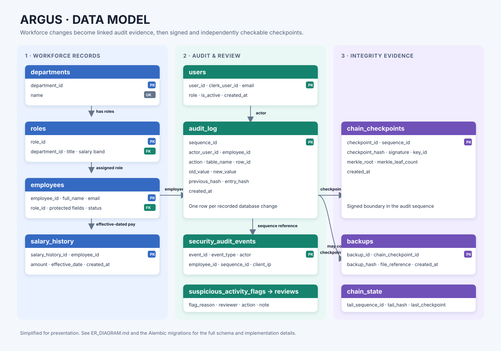
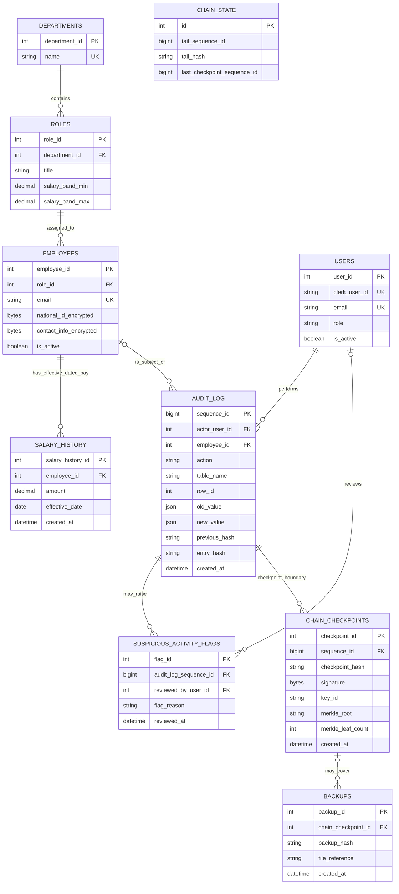

# Argus Hackathon ER Diagram

For a standalone image to place in slides, open or download [`ER_DIAGRAM.svg`](./ER_DIAGRAM.svg). Adminer remains useful for inspecting the live database, but its generated schema layout is not the presentation diagram.

This conceptual ER diagram shows the core relational model used in the HR audit prototype. Alembic migrations are the implementation source of truth; this diagram focuses on the entities needed to explain the payroll audit workflow to the review panel.

## How to explain it

- `departments`, `roles`, `employees`, and `salary_history` are the HR business data. Salary rows are effective-dated so past and future compensation changes can be reconstructed.
- Each business mutation produces an `audit_log` event that identifies the actor and affected employee when known. The event stores before/after payloads and links to the previous event by hash.
- `chain_checkpoints` records signed boundaries in the audit sequence. A checkpoint covers the audit interval ending at its referenced sequence; inclusion proofs use the checkpoint's Merkle metadata when available.
- `suspicious_activity_flags` links a review item to the event that triggered it. A user can be recorded as the reviewer.
- `chain_state` is a singleton serialization point for safe hash-chain appends. It is shown separately because it is operational state, not a business entity.
- A backup may optionally reference a checkpoint that was current when the backup was made.

The diagram is a presentation view, not a migration. It omits implementation-only columns and tables. The compact schema contract is [`contracts/schema_contract.sql`](../../contracts/schema_contract.sql), and the migration set is under [`db/alembic/versions/`](../../db/alembic/versions/).
